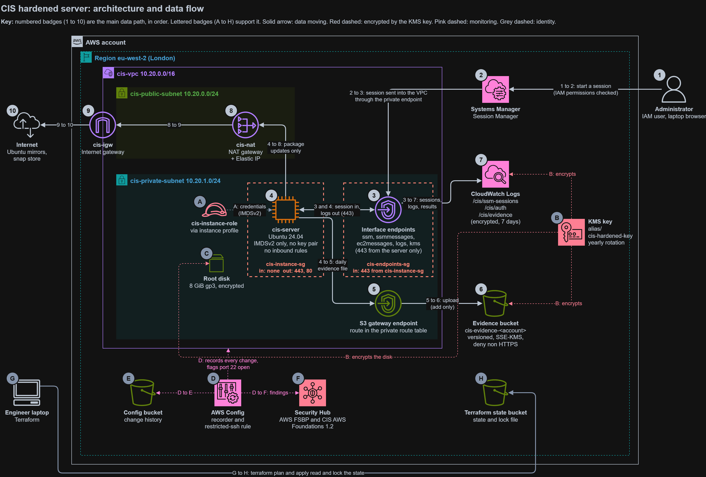
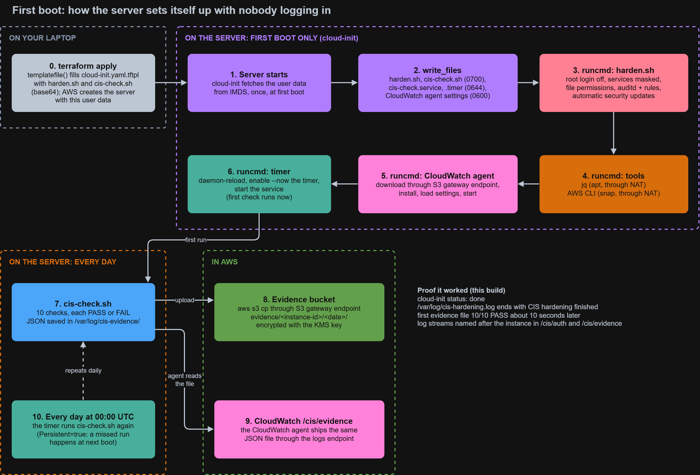
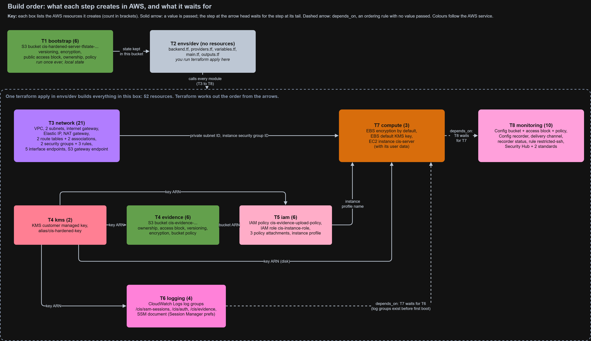

# CIS Hardened Server with Continuous Compliance Evidence

An Ubuntu 24.04 server on AWS that hardens itself to the CIS benchmark at first boot, checks its own controls every day, and stores the results as tamper resistant evidence. The whole environment is built, tested for drift and destroyed with Terraform.



Click the image for full size. The editable source of all diagrams is [docs/architecture.drawio](docs/architecture.drawio) (open it with draw.io).

**How to read it: follow the numbered badges 1 to 10, then the letters.**

1. **Administrator** (top right, outside AWS). Starts a session from the browser. No SSH, no key pair.
2. **Systems Manager.** Checks the administrator's IAM permissions, then sends the session on. Sessions close after 15 minutes idle and 60 minutes in total.
3. **Interface endpoints.** The private door into the VPC. The session reaches the server through them. Their security group, `cis-endpoints-sg` (red dashed box), accepts port 443 only from the server.
4. **cis-server.** The session opens here. The server never accepts incoming connections: its agents connected out to the endpoints first, and the session comes back down that connection. Logs go out the same way. Its security group, `cis-instance-sg` (red dashed box), has no inbound rules and allows outbound 443 and 80 only.
5. **S3 gateway endpoint.** Once a day the check script sends its JSON evidence file here.
6. **Evidence bucket.** Stores the file under `evidence/`. The server can add files but never read or delete them.
7. **CloudWatch Logs.** Receives, through the logs endpoint (3), everything the server's agents send: the Session Manager session recordings, the server's login log and the daily results.
8. **NAT gateway**, 9. **internet gateway**, 10. **internet.** The only route out, used for package updates. Nothing on the internet can start a connection in.

Supporting parts:

- **A. Role.** Gives the server short-lived credentials through IMDSv2, so no keys are stored on it.
- **B. KMS key.** Encrypts the evidence bucket, the logs and the disk (C).
- **D. AWS Config** records every change in the VPC, for example to the security groups, and flags port 22 open to the world. History goes to the Config bucket (E), findings to **Security Hub (F)**.
- **G. Terraform** on the engineer's laptop builds everything and keeps its state, with a lock, in the state bucket (**H**).

## What it demonstrates

- **Hardened by default.** The server applies five CIS controls at first boot with nobody logging in.
- **Continuous compliance.** A daily check maps each control to a CIS item and an ISO 27001:2022 control, writes the result as JSON and uploads it to an encrypted, versioned bucket the server can add to but never read, change or delete.
- **No SSH, no keys.** Access is through AWS Systems Manager Session Manager only. Every session is recorded under the real IAM identity.
- **Least privilege.** The server role can upload to one bucket prefix and use one KMS action, nothing more.
- **Drift detection.** AWS Config and Security Hub watch the AWS configuration from the outside, while Terraform restores anything it manages.
- **Infrastructure as code.** Seven Terraform modules, remote state in S3 with native locking, and a full build and destroy cycle.

## Architecture

**Network (eu-west-2, one Availability Zone)**
- VPC with a private subnet for the server and a public subnet for the NAT gateway only.
- The server has no public IP and no inbound rules. Its security group allows outbound 443 and 80 only.
- Interface endpoints for SSM, SSM messages, EC2 messages, CloudWatch Logs and KMS, so AWS traffic stays private.
- S3 gateway endpoint for evidence uploads. The NAT gateway is used only for Ubuntu package updates.

**Encryption**
- One customer managed KMS key, with yearly rotation, encrypts the server disk, the evidence bucket and the log groups.
- EBS encryption by default is enabled for the region as a preventive control.

**The server**
- t3.micro, official Canonical Ubuntu 24.04 image, IMDSv2 required with a hop limit of 1.
- cloud-init runs at first boot: hardening script, AWS CLI, CloudWatch agent, daily check script and its systemd timer, then a first check.

**Evidence and logging**
- Evidence bucket: private, ACLs disabled, versioned, SSE-KMS by default, and a bucket policy that denies non HTTPS requests and uploads asking for the wrong encryption.
- CloudWatch log groups, encrypted and kept for 7 days: Session Manager sessions, server authentication logs and the daily check results.

**Monitoring**
- AWS Config with the `restricted-ssh` managed rule.
- Security Hub with AWS Foundational Security Best Practices and CIS AWS Foundations Benchmark v1.2.0.

### First boot

The server configures itself through cloud-init, with nobody logging in:



## Controls checked daily

| Check | Control | CIS Ubuntu 24.04 | ISO 27001:2022 |
|---|---|---|---|
| CIS-01 | Root login over SSH disabled | 5.1 | A.8.2, A.8.5 |
| CIS-02 | Root password locked | 5.4 | A.8.2, A.8.5 |
| CIS-03 | Unused services masked (ssh, ModemManager, udisks2) | 2.x | A.8.9, A.8.20 |
| CIS-04 | /etc/passwd is 644 root:root | 7.1 | A.8.3, A.5.15 |
| CIS-05 | /etc/shadow is 640 root:shadow | 7.1 | A.8.3, A.5.15 |
| CIS-06 | auditd running | 6.3 | A.8.15 |
| CIS-07 | Audit rules for privileged commands loaded | 6.3 | A.8.15, A.8.2 |
| CIS-08 | Automatic security updates enabled | 1.2 | A.8.8 |

Each run produces one JSON file under `evidence/<instance-id>/<yyyy>/<mm>/<dd>/` with the expected value, the actual value and PASS or FAIL for every check.

The CIS Ubuntu benchmark is covered by the check script on the server. The CIS standard in Security Hub is a different benchmark that checks AWS account settings.

## Repository layout

```
docs/
  architecture.drawio  Editable source of the three diagrams
  *.png                The diagrams shown in this README
scripts/
  harden.sh            Boot hardening, five controls
  cis-check.sh         Daily compliance check and evidence upload
terraform/
  bootstrap/           S3 bucket for Terraform state (created once, local state)
  envs/dev/            The environment: backend, provider and module calls
  modules/
    network/           VPC, subnets, NAT, route tables, security groups, endpoints
    kms/               Customer managed key and alias
    evidence/          Evidence bucket and bucket policy
    iam/               Server role, upload policy, instance profile
    logging/           Log groups and Session Manager preferences
    compute/           EBS default encryption, the instance, cloud-init template
    monitoring/        AWS Config, restricted-ssh rule, Security Hub
```

## How to build it

Requirements: Terraform 1.10 or later and AWS credentials with administrator access.

1. Create the state bucket once:
   ```
   cd terraform/bootstrap
   terraform init
   terraform apply
   ```
2. Build the environment:
   ```
   cd ../envs/dev
   terraform init
   terraform plan
   terraform apply
   ```
3. After about five minutes the first evidence file appears in the evidence bucket, and the server can be reached through Session Manager.

Terraform works out the build order from the values each module passes to the next:



**How to read it: start top left and follow the arrows.** Solid arrows pass a value to the next step; dashed arrows are ordering rules (`depends_on`) with no value passed.

- **T1 bootstrap** creates the state bucket. It is built once, on its own, because Terraform needs somewhere to keep its state before it can build anything else.
- **T2 envs/dev** is the folder where the commands are run. It keeps its state in that bucket and calls each module.
- **T3 network** builds the VPC. It needs nothing from the other modules, so it is built at the same time as T4.
- **T4 kms** creates the key. Its key ARN flows to the evidence bucket, the IAM policy, the log groups and the server's disk.
- **T4 evidence** creates the bucket, encrypted with that key. Its bucket ARN flows to T5.
- **T5 iam** writes the upload policy, which names that bucket and key. Its instance profile flows to T7.
- **T6 logging** creates the encrypted log groups. They must exist before the server boots, or the CloudWatch agent would create unencrypted ones.
- **T7 compute** launches the server. It needs the subnet and security group (T3), the key (T4), the role (T5) and the log groups (T6), so it comes near the end.
- **T8 monitoring** switches on Config and Security Hub last, so they watch the finished build.

To deploy in a different AWS account, change the bucket name in `terraform/envs/dev/backend.tf` and the `BUCKET` value in `scripts/cis-check.sh`. Every other name is built from the account ID automatically.

## How to destroy it

```
cd terraform/envs/dev
terraform destroy
```

This removes all 52 resources. The state bucket in `bootstrap` is protected and stays for the next build. The KMS key waits 7 days before AWS deletes it.

The NAT gateway is charged by the hour, so the environment is meant to be destroyed when not in use.

## Results

- **Boot:** the server hardened itself and uploaded its first evidence file within a minute of the hardening finishing, with 10 of 10 checks passing.
- **Evidence:** the file was encrypted with the project key, and the bucket policy denied an upload using AES256 and a request over plain HTTP.
- **Least privilege:** the IAM policy simulator allowed uploads under `evidence/` and denied uploads elsewhere and every delete.
- **Session logging:** a Session Manager session appeared in CloudWatch with the IAM user, the instance and every command typed.
- **Drift test, part 1:** an SSH rule open to 0.0.0.0/0 was added by hand. AWS Config marked the security group NON_COMPLIANT. Terraform reported no changes, because it only tracks rules it created.
- **Drift test, part 2:** a rule managed by Terraform was deleted by hand. `terraform plan` detected it and `terraform apply` restored it.

The two drift tests show why both tools are used: Config detects changes to anything in the account, and Terraform corrects anything it manages.

## Design decisions

- **Session Manager instead of SSH.** No keys to lose or rotate, no open port, and every session tied to a named identity.
- **Write only evidence.** The server can add evidence but not read or delete it, so a compromised server cannot hide its own drift. Versioning keeps every earlier file.
- **Interface endpoints and a NAT gateway.** AWS traffic stays on the AWS network. The NAT gateway exists only because Ubuntu package mirrors are on the internet.
- **auditd without the auid filter.** The CIS rule filters on login user ID, which Session Manager sessions do not set, so the filter would discard every session event. Leaving it out is a documented deviation.
- **Security updates only.** Unattended upgrades install security patches automatically. Other updates would go through a tested patch cycle.

## Limitations

- Single Availability Zone and a single instance. This is a lab build, not a highly available design.
- The daily check covers eight controls, not the full CIS benchmark.
- Log retention is 7 days to keep cost low. A production build would keep logs for as long as audit requirements demand.
- The evidence bucket uses `force_destroy` so the lab can be torn down cleanly. In production it would be off, ideally with S3 Object Lock.
